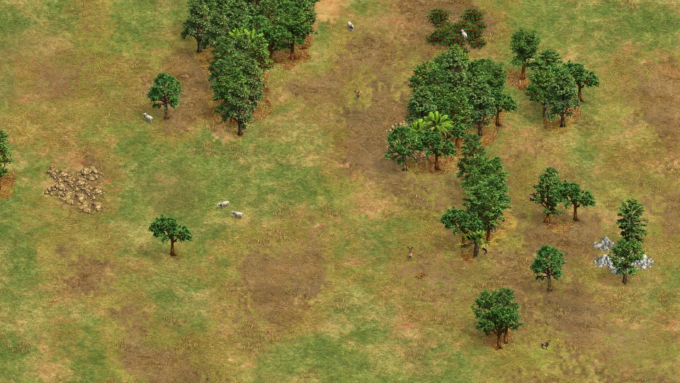
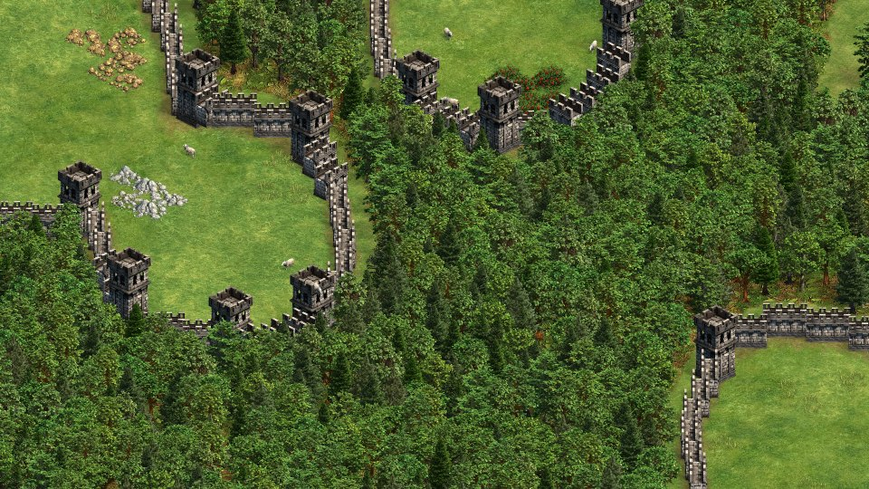
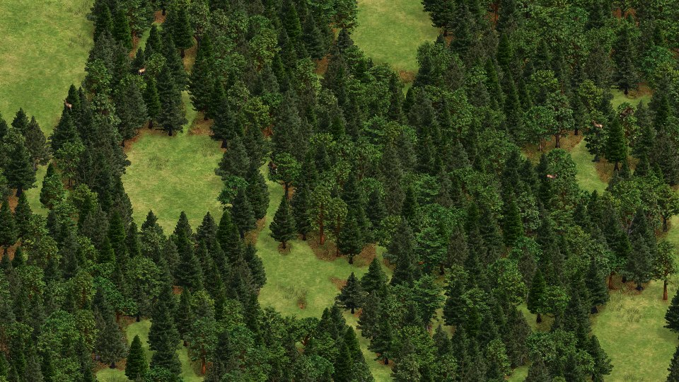
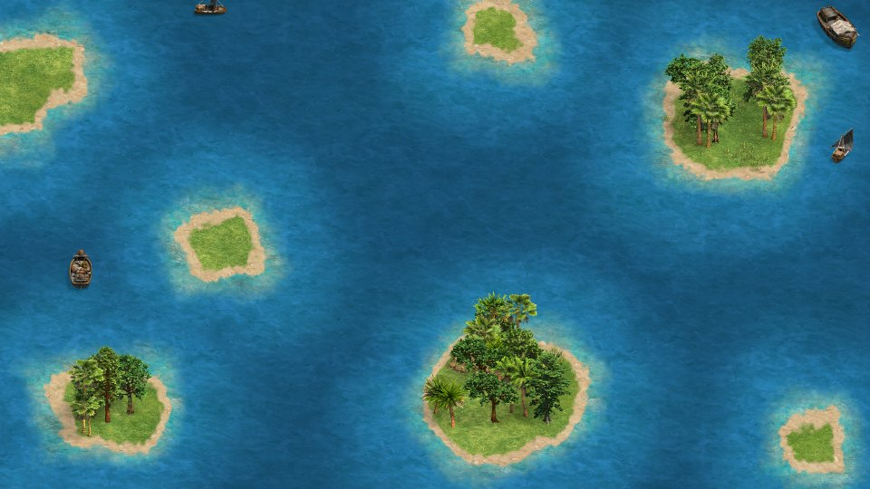
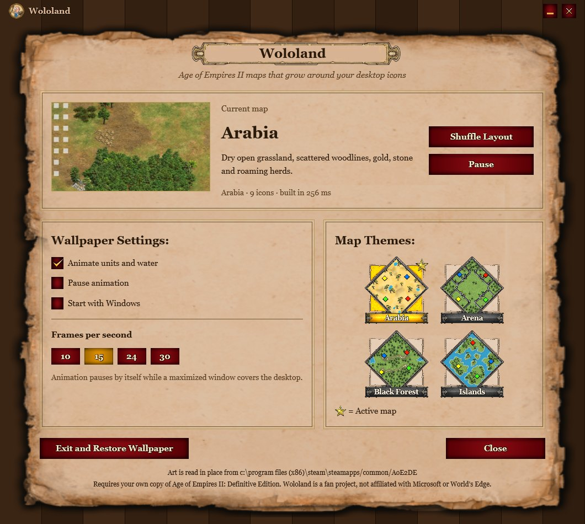

<p align="center">
  
</p>

<h1 align="center">Wololand</h1>

<p align="center">
  <b>Age of Empires II maps that grow around your Windows desktop icons.</b><br>
  A live wallpaper written in Rust with GPUI. It uses about 3% of one CPU core and draws its art from your own copy of AoE2: Definitive Edition.
</p>

<p align="center">
  <a href="https://ageofnotes.com/wololand/">Project page</a> ·
  <a href="#install">Install</a> ·
  <a href="#themes">Themes</a> ·
  <a href="#how-it-works">How it works</a> ·
  <a href="#building-from-source">Build</a>
</p>

<p align="center">
  
  
  
  
</p>

<p align="center">
  
</p>

---

## What it does

Wololand sits behind your desktop icons and turns the desktop into an Age of Empires II map.
It reads where your icons are and builds the scene around them. Clearings open up where your
shortcuts sit, woodlines and resources fill the space between them, and sheep, deer, wolves, birds
and ships move about. Rearrange your icons and the map regrows to fit, with a short crossfade.

- **Four map themes:** Arabia, Arena, Black Forest and Islands. Switch from the tray, the settings window or the command line.
- **Real game art:** sprites (`.sld`) and terrain textures (`.dds`) are decoded straight from your install. Nothing is copied or redistributed.
- **Light on resources:** the map is baked into a single texture, so each frame only redraws the water and a handful of animated units.
- **Gets out of the way:** animation pauses when a maximized or full-screen window covers the desktop.
- **Recovers by itself:** if Explorer restarts, Wololand re-attaches within about two seconds.
- **Feels like the game:** the settings window uses the game's own menu art. That covers the parchment, red buttons, checkboxes and map-pool frames.

## Themes

| | |
|:---:|:---:|
| <br>**Arabia**: dry open grassland, scattered woodlines, gold, stone and roaming herds | <br>**Arena**: your icons walled in by stone, with a ring of forest outside the gates |
| <br>**Black Forest**: dense dark forest with clearings and paths around your icons | <br>**Islands**: every icon cluster is an island, and ships sail between them |

<p align="center">
  
</p>

## Install

1. You need **Age of Empires II: Definitive Edition** installed (Steam or Xbox / Game Pass).
2. Download `wololand.exe` from the [Releases](../../releases) page, or [build it yourself](#building-from-source).
3. Run it. The settings window opens: pick a map theme and you're done.

Wololand lives in the notification area. Right-click the monk for themes, shuffle, pause and exit.
**Exit** restores your normal wallpaper. Tick *Start with Windows* to launch it quietly at sign-in.

The game is found automatically through the Steam registry and `libraryfolders.vdf`, then the default Steam path,
then the Xbox path. If yours lives somewhere else, set `game_path` in `%APPDATA%\Wololand\settings.json`.

## How it works

| Part | What happens |
|---|---|
| **Behind the icons** | On Windows 11 24H2 and later, the window becomes a layered child of `Progman` placed just below `SHELLDLL_DefView`, and a WinEvent hook keeps it there. On older builds it goes inside the `WorkerW` behind the icon host. |
| **Icon-aware layout** | Icon rectangles are read from the desktop `SysListView32` every 400 ms. A soft distance field around them drives the terrain blend, tree lines, walls, islands and paths. |
| **Asset decoding** | A small SLD decoder (BC1/BC4 blocks, shadow layer) and a DXT1 DDS reader load sprites and terrain from the install, in memory only. |
| **Scene build** | Terrain is blended per pixel across threads, then objects are placed on the isometric grid, depth-sorted and blitted. A rebuild takes 200–300 ms on a background thread. |
| **Rendering** | GPUI (DirectX 11) draws one baked texture, two drifting water layers and the unit sprites, capped at the frame rate you choose (10–30 fps). |
| **Units** | Animals and ships walk only on open ground near your icons, never under tree canopies. Ships stay in deep water. |

On a 1920×1080 desktop animating at 15 fps it uses **about 3–4% of one CPU core** and **about 140 MB** of memory.
Paused or covered, it uses close to nothing.

## Command line

| Command | Effect |
|---|---|
| `wololand.exe` | Start (or bring up the settings of the running instance) |
| `wololand.exe --autostart` | Start silently in the tray |
| `wololand.exe --theme arabia\|arena\|blackforest\|islands` | Switch the theme of the running instance |
| `wololand.exe --exit` | Quit and restore the normal wallpaper |
| `wololand.exe render <theme> <out.png> [w h icons]` | Render a scene offline around sample icons |
| `wololand.exe montage <file.sld> <out.png> [step]` | Contact sheet of a sprite's frames |
| `wololand.exe dump <file.sld\|.dds> <dir>` | Write frames as PNG |
| `wololand.exe texsheet <dir> <out.png>` | Thumbnails of terrain textures |

Logs go to `%APPDATA%\Wololand\wololand.log`.

## Building from source

Requirements: Windows 10/11, a recent stable [Rust](https://rustup.rs) toolchain and the Windows SDK (for `rc.exe`, which embeds the icon).

```
git clone https://github.com/gregstein/wololand.git
cd wololand
cargo build --release
```

The binary is `target\release\wololand.exe`.

```
src/
  main.rs       entry point, single instance, CLI helpers
  app.rs        GPUI windows: the wallpaper and the settings UI
  desktop.rs    attaching behind the icons, reading icon positions, cover detection
  scene.rs      map generation per theme
  actors.rs     animated units
  assets.rs     locating the game and loading sprites/textures
  aoe/          SLD, DDS and BC1/BC4 decoders
  tray.rs       notification-area icon and menu
  settings.rs   settings file and start-with-Windows
```

## Author

Made by **Mohammed Amine Belbachir** ([GregStein](https://github.com/gregstein)), the creator of
[Age of Notes](https://ageofnotes.com) and of other free AoE2 tools such as
[AoE2Tools](https://github.com/gregstein/AoE2Tools), [DE Replays Manager](https://github.com/gregstein/DE-Replays-Manager)
and [Sensei DE](https://github.com/gregstein/SenseiDE).

## License and legal

The Wololand source code is released under the [MIT License](LICENSE).

Age of Empires II: Definitive Edition and its art are © Microsoft Corporation. Wololand is an unofficial fan project,
not affiliated with or endorsed by Microsoft or World's Edge. It ships no game assets. Everything you see is read at
runtime from a copy of the game you own.
